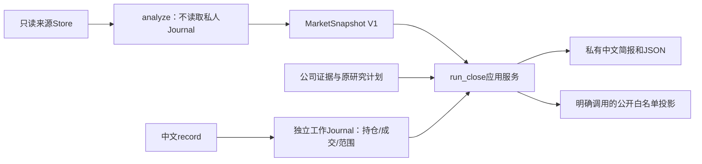

# 日常任务与中文录入 M1

适合收盘后、盘前集中处理及数周到数月持有。当前实现为离线命令与中文简报；真实数据仍停留在已取得的日期，未部署后台更新或提醒。

## 使用入口

```bash
# 检查配置；不打开数据库或创建输出
.venv/bin/astock research daily --profile config/daily/retained-evidence.json --check

# 重现固定观察：10月14日研究、10月12日行情
.venv/bin/astock research daily --profile config/daily/retained-evidence.json

# 中文问答录入：已阅/备注、持仓快照、已发生的实际成交
.venv/bin/astock research record --profile config/daily/retained-evidence.json

# 新一次本地观察；行情要求日期必须显式填写，不会联网补行情
.venv/bin/astock research daily --profile config/daily/retained-evidence.json \
  --observe-now --market-date 2026-10-14
```

个人日常配置可放ignored的`data/private/`内，保持真实/模拟Journal分目录。这里的真实配置用于保留证据重查，不是完整的当日交易服务。不要向真实配置填演示成交；公开演示使用独立SIMULATED工作区。

固定run文件不会因命令改写。省略观察参数会重现固定历史观察，新录入不会回填进早于录入时间的旧报告。新观察同时提供`--observe-now`和`--market-date`；重放指定观察用`--observed-at 带时区时间 --market-date 日期`。日期是数据核查要求，不能当作数据已取得证明。

## 录入如何影响下一次报告

|录入|下一次私有报告|保留的未知与待办|
|---|---|---|
|已阅/研究备注|显示原文、事实时间与录入时间|不解除研究风险，不修改持股数、现金或待核对成交|
|持仓快照|用明确股数更新该证券的已报持仓|其他持仓不被删除；完整性和现金须本次明确声明|
|实际成交及成交后持仓|保存成交事实和明确补录的剩余股数|不从成交价/数量推算现金，不生成订单|
|实际成交但不填成交后持仓|保留原已报股数并标记待核对|不擅自减仓；账户总资产/权重保持未知|
|明确股数0|结束该证券的已报持仓|不能据此认定整个账户空仓；需另有完整性与现金声明|

例如已报200股，实际卖出100股且明确补录剩余100股，下一份报告为100股。只录“卖出100股”时仍保留原200股并提示对账。备注“已阅”不能清除此提示。原持仓逻辑随快照引用保留，新的文字声明不改写过去判断。

每次写入在受管锁和同一事务中保存INPUT回执、POSITION/EXECUTION/REVIEW及ACCOUNT声明；中途失败整体回滚。同一请求号和相同内容可幂等重试；不同内容冲突会拒绝。写入前重新检查持仓预览Hash，防止另一笔录入使预览过时。问答最终保存前可取消；`--request-id`可用来恢复明确的重复请求。

V1不支持用较早快照覆盖同股较新的快照。历史成交可以补录，未补相应持仓时继续待核对。修改错误事实需追加可追溯更正，底层更正链拒绝跨证券、跨事件种类或分叉；问答版更正入口仍待实现。

## 同一计算与应用路径



`daily`和旧`decision-close`调用同一个`decision.application.run_close`，旧命令只做参数适配。原公开JSON不再充当核心行情接口；来源向量压缩为共享纯函数。研究Store继续原字节复算和用途校验。旧公开基线因执行版本不同不能直接整份Hash相等时，必须找到并验证原Store内精确旧快照锚点，再逐项复现所有公开业务字段；仅代码Hash和原私有快照Hash作为执行元数据分别保留。数值、参数、来源、时间、缺口变化仍拒绝。

这一步沿用独立工作Journal的五表容器，扩展类型化事件，不升级或写入冻结行情原库。未来业务对象需要新表时使用独立版本schema；当前不提前迁移真实来源。私人回执、持仓和现金仅进入私有输出；公开投影不含这些字段。

报告对还绑定渲染源码Hash，格式迭代生成新JSON/Markdown文件，不覆盖旧版本；相同版本/相同内容重跑幂等。渲染版本不改变已保存的研究观察和历史判断。

## 研究计划与明确复核

```bash
.venv/bin/astock research plan --profile config/daily/retained-evidence.json
```

中文问答支持新增/重开计划、结束研究观察、明确复核当前证据；配置run及原计划不改写，操作追加到独立工作Journal。新计划必须有基线公司目录与市场证据，指标必须来自保留财务条目，创建时间为实际录入时间，不补造过去判断。当前两份真实目录均有8家公司；三个初始判断案例不是全部可用研究对象。

新增计划填写研究逻辑、关注原因、可观察检查、反证、暂不交易理由、指标和研究复核时间。问答首版录一个指标，类型化服务支持多个；研究提醒日期不是已批准的交易退出参数。当前同一配置/基线最多20个对象，基线变更会拒绝静默套用旧计划；跨基线迁移与任意新公司证据录入仍待后续实现。

结束观察不代表卖出，仍有已报持仓时继续优先提示风险；重开须创建新计划版本，原逻辑和持仓原始判断保留。明确复核绑定当时整份目录版本及该公司来源Hash；目录改变后不会自动复用旧复核去解除新问题。普通“已阅”继续只作为备注。重大未决风险和真实交易限制不因明确复核自动解除。

若以后最新目录缺少某个已计划对象，仅组合保留材料并保持其原始来源时间，报告明确列为待刷新/UNKNOWN；不推断已经完成本轮复核。新增来源仍须按对应范围验收，计划录入不会采集。

## 今日先处理

私有报告开头按对象合并持仓对账、报价时效、逻辑反证、到期和证据变化；同一对象保留全部原因，优先显示持仓/风险，再显示研究与信息待补。已结束但仍有持仓的对象继续保留。

`config/daily/workflow-v1.json`固定首版研究提醒7自然日、可见待办8项；这些是产品默认值，不是风险阈值。超出可见上限的项目仍保存在私有JSON，备注已阅不关闭，事实修复或明确研究操作后再计算。公开投影不包含私人待办、操作理由或组合。

## 运行回执与显式恢复

```bash
.venv/bin/astock research daily-status --profile config/daily/retained-evidence.json
# 把下方“实际任务号”替换为daily/status输出的32位任务号
.venv/bin/astock research daily --profile config/daily/retained-evidence.json --resume 实际任务号
```

每次正常运行保存不可覆盖的启动及终态回执，记录观察时间、输入/代码/当时人工事实Hash、失败阶段及恢复建议；不保存原始异常文本或凭据。只有启动回执时保持“运行中或已中断”，不能据此认定仍有进程或已经成功。状态查询不打开数据库，来源文件缺失时也可读取已有回执。

恢复是新的离线尝试，引用原任务并使用原观察时间和行情要求日期；已有日志和文件不删除。报告只写出JSON或观察只持久化了一部分时，经过同版本/同输入核验后幂等补齐。代码、配置或当时可见的人工事实改变会拒绝冒充原任务恢复，需核对后新建观察；旧入口补写历史时间的事实也会触发该保护。启动前检查配置失败时不创建正常运行回执。

恢复不重置消费、FAILED/UNKNOWN或交易状态，不重新发市场API。没有部署自动重试/后台提醒；磁盘/权限导致回执也无法写入时，命令会明确提示终态未保存。

## 验收与未完成项

[本批真实重查与合成闭环证据](research/results/2026-10-15-daily-workflow/README.md)。已经覆盖错误模式/未来事实拒绝、原子回滚、幂等与预览竞争、已阅不解风险、晚录不回填、未知现金及公开隔离。

计划、待办和恢复的[实际演示与机器证据](research/results/2026-10-15-plans-and-recovery/README.md)已追加；当前实现的完整CI和真实连续使用分别验收。真实账户尚未提供，真实新行情/公告更新未执行。任意新公司证据接入、跨基线计划迁移、复杂持仓更正问答、策略候选与统一退出/PAPER继续按[路线](ROADMAP.md)推进；不以软件闭环或合成通过宣称真实策略有效。
