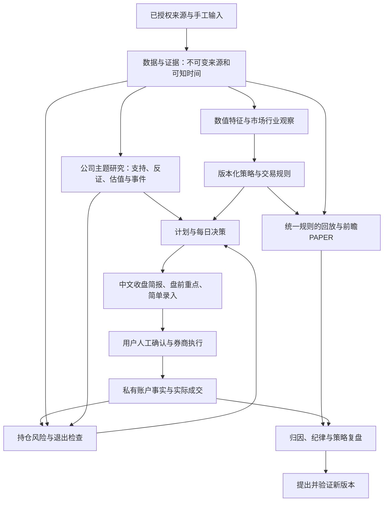

# 系统设计、资产取舍与实施预期

2026-10-15启动实施。用户已确认“先给整体计划，然后开始”；实现基线为`83a9c8819baa2c8986c74116ddd0c4aff8cd140a`，包含Decision Loop V0及交接。本文固定本批设计、范围和排期，进度由[CURRENT_STATE](CURRENT_STATE.md)维护，验证由[REVIEW](REVIEW.md)维护。计划中的能力和清理不因此算作完成；不改变历史消费事实。

## 用户已明确的产品与合作选择

- 收盘后、盘前集中处理，主要持有数周到数月。
- 先交付中文报告和简单录入，页面以后再加。
- Codex负责总体方案、研究与工程衔接、普通实现、验证、修复和推进；GPT仅由用户按需介入，不再是固定开发/交付关口。
- 真实数据新增范围、真钱风险参数/交易及不可恢复私有删除继续按明确授权处理。

## 已有资产的处置

|资产|处置|具体依据与改动|
|---|---|---|
|Research采集、证据链、原子发布、锁、时点与来源语义|复用|已有合法来源读回、故障和篡改保护；适配新用途，不重建整套平台|
|features、regime、radar、screening数值实现|复用并演进|已经用于真实市场计算；策略使用数值特征，描述性标签与交易许可分开|
|公司来源/单位/期间模型、31份披露、人工研究目录|复用|有来源定位与时间边界；从固定目录演进为按事件更新的证据和判断|
|Journal、Decision Loop、只读增量组合|迁移演进|沿用事件追加与来源引用；补业务对象与简单录入，摆脱三公司特例和报告JSON耦合|
|旧Phase1/probe/slice/admission/full-backfill活跃写入口|退出新业务|不再投入扩展；先迁出仍被复用的辅助函数、验证历史读回，再移除重复生产入口|
|compat/phase1及历史版本注册|冻结保留|动态decoder和hash仍被历史来源依赖；体积很小，删除没有容量意义|
|portfolio/backtest/catalysts等Reserved包、disabled顶层配置|尚无相应完整能力|目录或配置名不能算业务成果；按实际需求落地，不另造一套平行实现|
|重复演示、通过测试临时库、性能测量中间副本|优先清理候选|不需要作为长期投资资产保留；完成所有权/引用/复现/失败证据核验后移除|
|不可替代Raw、失败/UNKNOWN消费、真实研究/个人日志和唯一备份|保留必要事实|清理副本与派生物不改变原事实；归档和恢复方法必须可检验|

静态导入盘点覆盖97个生产Python文件，源码约0.867MB；它不是完整动态可达性证明。源码结构需要整理，但几十GB问题主要来自数据副本、历史演练和临时库。源码迁移采用按消费者替换，不以文件名或静态无入边单独批准删除。

## 本次容量实测

2026-10-15北京时间11:22:12—11:23:00只读stat盘点，沿用最近交接的15个确认项目根。完整性通过，无扫描错误，不跟随符号链接；没有删除。

|范围|逻辑占用（十进制GB）|说明|
|---|---:|---|
|当前checkout|20.114|代码、环境、Git、data、reports等|
|其中data|约19.309|属于上行子集，不重复相加|
|仓库外历史工作目录|8.204|旧Review、SQL工作副本、测试目录与输出混存|
|四个pytest根|13.266|优先核验的可再生测试候选，非新增股票数据|
|九个已确认临时演示根|0.214|同属候选，先确认是否含必要失败证明|
|全部15根|41.798|文件分配blocks去重为42.839GB；不等于APFS物理占用|

当前data/private约17.412GB，其中：

- 旧combined-remediation-b-rehearsal约9.512GB。
- r2-b-v2-execution约1.530GB。
- finite45-formal-execution约1.175GB。
- 当前research-v1约1.071GB，research-v3约0.097GB；包含来源、存储及相关演练，不等于纯原始行情大小。

若四个pytest根全部经验证并获准移除，按本次口径工作集约降至28.532GB。此数字是候选逻辑长度的条件计算，不是已释放空间或已批准清单。对9.512GB历史目录和8.204GB外部目录，需分离唯一来源、消费/失败证据与可重建数据库，暂不承诺可释放量。

私有精确路径/大小/引用检查与候选保存在本次repository-governance审计目录。只对同大小数据库做了约4GB有界hash读取，不是全历史hash审计；相同hash也不自动证明其中一份可删。旧容量快照与本次差异不代表手工删除。

## 清理与长期生命周期

第一批先处理四个pytest根及确认的临时演示；逐项形成来源/依赖/保留证据/重建命令/验证结果，再确认一次实际清理范围。现在没有执行删除。

随后拆解旧演练与外部工作目录：

1. Raw、消费、失败现场和真实记录留唯一权威版本，并保留必要备份。
2. 可再生SQL库、重建库、测试副本只保留必要锚点与恢复说明。
3. 对压缩归档实际测压缩率、校验清单、隔离解包及读回；验证后再提出移除原目录。移动到外置盘仍计项目总量，不把移动称作总量减少。
4. 迁移期间不生成整套额外备份；先估峰值，只处理一个有界批次。

新增产物必须登记category、owner、run/source引用、大小、重建命令、保留规则、保护原因与引用关系。没有这些字段的任务不得自动留下长期目录。

拟采用的规则：

|类别|拟定保留规则|
|---|---|
|原始来源、消费事实、真实决策与成交、实验定义/所有变体摘要|长期留存、内容寻址与增量备份；不进入缓存清理|
|数值特征和查询缓存|可重建，初期2GB上限、7天滚动；只清受管且确认可再生的目录|
|通过测试的临时数据库|保留测试结果与输入版本，临时库随任务结束回收；后续实现需明确授权的受管范围|
|失败测试产物|保留最小失败输入、日志和重现步骤；按问题关闭情况处理，不永久冻结全套工作树|
|报告草稿/中间抽取与性能演示|7天滚动或任务结束退出；正式真实研究记录保留|
|测试峰值|先按当前约6GB完整测试峰值预算；通过fixture复用/按组释放降低，不能重复制多轮全套|

上述是待实现策略，不是已部署自动清理。目标50GB、上限100GB；首发新增工作集预算不超过2GB（现有测试峰值另列），超出先解释具体原因和取舍。希望整理后维持约25—30GB起步工作集，但保护资产的实际恢复核验决定能否达到。

## 目标架构

采用单机模块化应用，不拆微服务。来源存储保留既有Research Store；新增业务工作区采用独立版本schema，保存研究版本、计划、账户、动作和运行状态，不向冻结五表源库硬塞所有业务表。沿用DuckDB、受管锁和单写入路径。

应用服务返回明确的MarketSnapshot、FeatureSnapshot、ResearchThesis、Setup、TradePlan、PositionReview和DecisionItem。报告及以后页面消费同一应用服务；不再把公开报告JSON作为核心数据接口，也不把私人Journal放进通用行情计算。

策略观察资格、研究判断、PAPER资格、真实账户风险和执行条件分别表达。缺账户不阻止观察/实验，满足Setup不产生真钱许可；已有持仓的风险不因报价或其他资料缺失消失。确认已阅不代表风险已解除。

首个策略研究候选为日线趋势回踩，突破及简单趋势为对照；按用户数周至数月的节奏设计。参数、进出/取消、基线、成本、可成交约束和失败标准先冻结。规则化条件共用于日常与实验；AI研究干预按真实取得时点前瞻留档，单独归因，不能回填历史。

全市场数值扫描保留，深度研究集中于持仓/计划/接近Setup的对象。公司、行业、主题、估值与催化应解释经济驱动和反证；不扩建通用新闻/PDF档案平台。首先支持收盘后和盘前，后续提醒能力须实际部署和验证。

## 开发顺序、预计工作量与时间点

按一个主执行者、约6—10个有效开发日估算；T0为2026-10-15。目标日期按每天有持续执行窗口估算，周末不作为承诺工作日。现在开始当前会话内的实施；未部署后台开发或日更任务。数据审批、私有恢复核验及环境问题会改变日历，工程推进与真实样本积累分开报告。

|目标点|工程预期|目标日期|用户可见验收|
|---|---|---|---|
|M0：资产边界和运行入口|第1—2有效开发日|10月16日前|精确首批清理/恢复核验；新产物生命周期；接住已有Decision Loop，减少重复参数|
|M1：首个可用中文日常任务|累计第3—4日|10月20日前|已有/获批新来源→规则观察与持仓检查→中文简报→简单录入→下一次接续；数据陈旧如实标识|
|M2：完整策略与PAPER机制|累计第5—7日|10月23日前|同一策略从信号、取消、风险到模拟执行/退出和归因；真实与模拟分开，负结果保留|
|M3：稳定试用与迁移收敛|累计第8—10日|10月28日前|真实连续使用范围内的数据更新、错误恢复、低噪声待办；旧重复入口退出；容量与维护成本实测|

真实日更需要对应有限来源范围获授权。未取得新数据时可交付软件，但M1/M3真实日常使用验收保持未完成。实际持仓未提供时以观察/PAPER运行，不声称真实组合已接入。

前瞻观察随后连续积累：首轮4—8周重点验证是否可执行、是否改善纪律和判断负担；数周到数月的持有周期通常无法在几天内证明统计优势。策略效果依据真实信号/交易样本、对照、成本和不确定性决定，不能把固定周数当有效性通过条件。

每个目标点由Codex完成实际diff自查、相关反例、必要完整回归与业务演示，随后继续推进；GPT无固定Gate。当前未核验远端PR状态，不沿用旧CI宣称新实现已验收。必要完整集成回归在有界、独立的新测试目录执行，避免默认pytest轮换删除旧受保护临时根。

## 最终可见效果与本轮边界

用户每次只需阅读一份中文简报，并补录少量真实处理。报告优先给重要风险、原计划变化、机会/取消原因与下一动作；证据和计算可追溯。记录会进入下一次报告，实际成交与计划、研究结束、已阅回执分别处理。

当前提供的是全虚构公司的交互预演，包含收盘简报、简单录入及下一次观察，用于讨论产品行为。它不连接实际Store/Journal，没有市场请求或真实成交，也不代表生产功能已实现。

启动批次已新增`research daily --profile`入口：读取一次配置，直接调用既有`decision-close`，没有第二套决策计算。`--check`只检查配置/路径/账户模式，不打开数据库或创建输出；不能当作市场数据已验收。固定观察时间必须显式存在于run输入，命令不自动改成当前时间。

首个配置`config/daily/retained-evidence.json`重查既有10月14日研究与10月12日行情，写入新的小型私有Journal和报告目录，不覆盖既有冻结交付。它用于入口验证，不能称作真实新交易日观察。

本批没有删除私有数据或执行真实市场API；源码/测试和检查结果以CURRENT_STATE/REVIEW为准。
